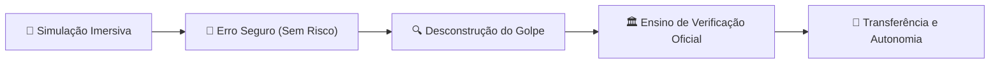

# 🛡️ Plataforma Interativa de Treinamento e Assistência em Segurança Digital

> **Missão do Projeto:** Promover autonomia e segurança digital por meio de experiências práticas, acessíveis e inclusivas, ensinando pessoas a reconhecer sinais de risco, verificar informações por fontes confiáveis e tomar decisões mais seguras no ambiente digital.

---

## 🎯 Frase-Síntese

> *"Não queremos ensinar as pessoas a decorar golpes. Queremos ensiná-las a saber quando parar, desconfiar e verificar."*
> 
> **Lógica Central:** **RECEBI → PAREI → DESCONFIEI → VERIFIQUEI → CONFIRMEI → AJA**

---

## 💡 O que é a Plataforma?

A plataforma é um ambiente digital interativo projetado principalmente para **pessoas idosas** (mas aberto a qualquer usuário), focado no aprendizado prático por meio de **simulações imersivas** de fraudes do cotidiano (WhatsApp, SMS, E-mails, Bancos, Compras, Entregas, etc.).

Ao invés de cartilhas passivas ou alertas genéricos:
1. **O usuário vivencia a situação** em um ambiente fictício e seguro.
2. **Pode errar deliberadamente sem risco real** (sem transações bancárias reais ou perda de dados).
3. **Aprende com o "Susto Seguro":** O sistema interrompe no momento crítico, acolhe o usuário, desconstrói os gatilhos emocionais da fraude e ensina passo a passo a encontrar o canal oficial de verificação.
4. **Assistente de Segurança em Tempo Real ("Estou em dúvida"):** Permite que o usuário descreva uma situação real (por texto ou voz) e receba orientações preventivas imediatas.

---

## 📚 Índice da Documentação do Projeto

Toda a documentação estruturada do projeto está organizada na pasta [`docs/`](./docs/):

* 📄 [**01. Visão e Conceito Pedagógico**](./docs/01_VISAO_E_CONCEITO.md): Problema, público-alvo, acessibilidade multimodal (áudio/voz/visual), metodologia do erro seguro e métricas de sucesso.
* 🏗️ [**02. Arquitetura e Módulos do Sistema**](./docs/02_ARQUITETURA_E_MODULOS.md): Detalhamento dos 5 módulos conceituais, escopo do MVP de 1 semestre, assistente de IA, hiperlocalização e roadmap de evolução.
* 📋 [**03. Product Backlog Completo**](./docs/03_PRODUCT_BACKLOG.md): Todos os 10 Épicos, 43 Histórias de Usuário (US01 a US43), prioridades e tasks técnicas.
* 🏃 [**04. Roadmap e Acompanhamento de Sprints**](./docs/04_ROADMAP_E_SPRINTS.md): Planejamento das Sprints 1 a 10, definição do MVP e checklist dinâmico de status (*Onde já estamos e o que falta*).

---

## 🧭 Pilares Fundamentais

