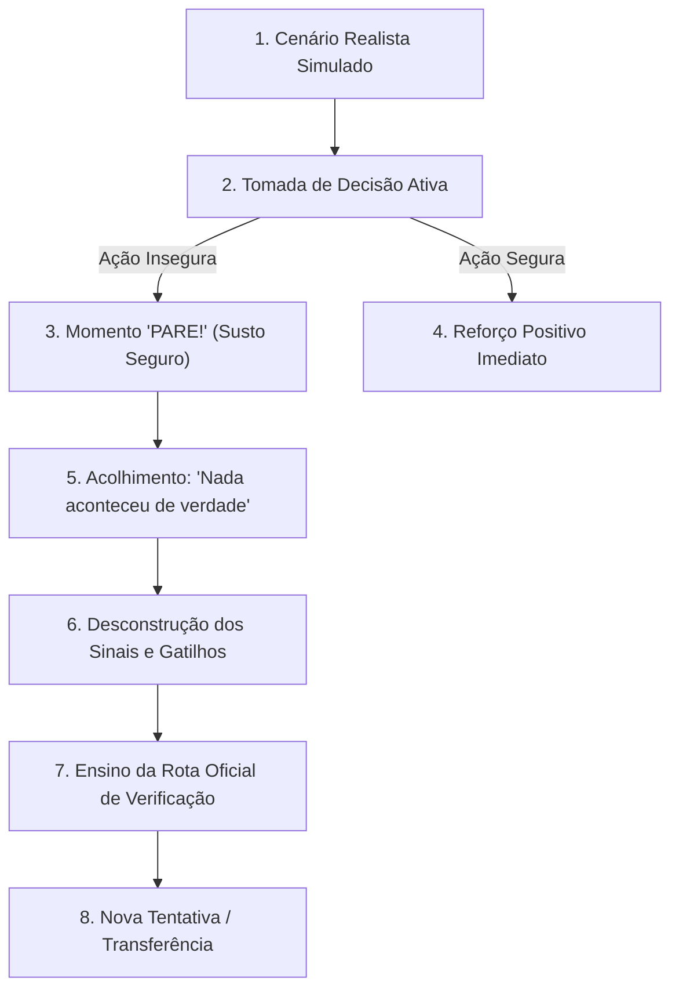

# 01. Visão Geral e Conceito Pedagógico

## 1. Problema Central

O problema que a plataforma resolve vai muito além de "idosos caem em golpes":

> **Muitas pessoas não possuem conhecimento prático, experiência ou confiança suficientes para identificar situações de risco no ambiente digital e, principalmente, não sabem como verificar uma informação antes de tomar uma decisão prejudicial.**

### Por que cartilhas e avisos tradicionais falham?
- **Golpes mudam constantemente:** Decorar que "o golpe X do WhatsApp é falso" não prepara o usuário para a variante de amanhã.
- **Engenharia Social ataca emoções, não a razão:** Golpistas usam urgência, medo, autoridade, afeto familiar, falsa oportunidade e isolamento para forçar uma ação impulsiva.
- **Falta de método de verificação:** A pessoa frequentemente pensa: *"Não sei se é golpe, então vou clicar para descobrir"*.

---

## 2. A Solução e a Lógica Central

A plataforma ensina uma competência duradoura e transferível: **saber parar, desconfiar e verificar por fontes autônomas e independentes**.

$$\text{RECEBI} \longrightarrow \text{PAREI} \longrightarrow \text{DESCONFIEI} \longrightarrow \text{VERIFIQUEI} \longrightarrow \text{CONFIRMEI} \longrightarrow \text{AJA}$$

### Regra de Ouro Pedagógica
> **"Não preciso ter certeza de que é golpe para parar."**
> Dúvida $=$ Pausa $+$ Verificação.

---

## 3. Público-Alvo e Princípio de Inclusão Radical

Embora a plataforma sirva para qualquer cidadão, o foco prioritário são **pessoas idosas**, respeitando a diversidade desse público (diferentes graus de alfabetização, mobilidade motora, familiaridade digital e autonomia).

### Princípio Fundamental de Design Inclusivo
> **A leitura não pode ser um requisito obrigatório para aprender e se proteger.**

O sistema adota acessibilidade nativa multimodal desde o Dia 1:
- **Visual:** Ícones grandes, cores de alto contraste, tipografia legível, elementos de interface simplificados e diretos.
- **Áudio (TTS):** O sistema narra mensagens, perguntas, instruções e explicações com um toque.
- **Voz (STT):** O usuário pode falar com o sistema em vez de digitar.
- **Linguagem Natural e Acolhedora:** Textos curtos, diretos e sem jargões técnicos herméticos (ex: nada de *"ataque de phishing com engenharia social"*, mas sim *"Calma, vamos olhar isso juntos"*).
- **Sem infantilização:** Comunicação respeitosa, adulta e empática.

---

## 4. Metodologia Pedagógica: O "Susto Seguro" e a Aprendizagem Ativa

### O Conceito do "Susto Seguro" (Erro Seguro)
- O usuário pode prosseguir até tentar fazer o Pix ou preencher o formulário fictício.
- O sistema interrompe: **🚨 PARE! Você acabou de cair em uma simulação de golpe.**
- Imediatamente acolhe: **"Fique tranquilo(a). Nada aconteceu de verdade. Este é um ambiente 100% seguro para treinar."**
- O erro vira alavanca de fixação mnemônica e reflexão, sem trauma financeiro ou moral.

---

## 5. Gatilhos de Manipulação Mapeados

O sistema ensina o usuário a reconhecer as táticas de manipulação psicológica:
1. **Urgência:** Pressão de tempo para agir sem pensar.
2. **Medo:** Ameaça de bloqueio de conta, multa ou processo.
3. **Autoridade:** Fingir ser banco, polícia, tribunal ou órgão público.
4. **Confiança/Afeto:** Passar-se por filho, neto ou amigo ("troquei de número").
5. **Recompensa/Ganância:** Promessas de prêmios, descontos absurdos ou dinheiro fácil.
6. **Isolamento:** *"Não conte para ninguém, resolva comigo agora"*.

---

## 6. Ensino da Busca Ativa da Fonte Oficial

O usuário é treinado para **não confiar no canal que veio até ele**, mas sim **buscar a fonte verdadeira de forma autônoma**:
- **Bancos:** Fechar a mensagem, abrir o aplicativo bancário oficial já instalado, olhar o telefone no verso do cartão físico ou ir à agência.
- **Órgãos Públicos:** Acessar o portal oficial digitando o endereço ou buscando canais oficiais de atendimento.
- **Familiares:** Ligar para o número antigo gravado na agenda, fazer chamada de vídeo ou falar pessoalmente antes de qualquer transferência.

---

## 7. Os Dois Eixos Pedagógicos de Aprendizagem

A plataforma opera sobre dois pilares complementares de neuroaprendizagem gerontológica:

1. **Eixo em 1ª Pessoa — A Vivência Prática (Simulador com Susto Seguro):**
   * O participante vive a fraude em primeira pessoa, experimentando a pressão emocional em ambiente protegido.
   * Ao errar, passa pelo momento de interrupção empática ("🚨 PARE!"), desconstrução dos gatilhos e rota de superação.
2. **Eixo em 3ª Pessoa — A Mentoria Descentrada (Pílulas de Boas Práticas da Dona Maria):**
   * Em micro tutoriais interativos de até 5 minutos, o idoso assume o papel de **conselheiro protetor da personagem Dona Maria**.
   * Ao sair do foco de pressão direta e aconselhar um par, a ansiedade diminui, o raciocínio crítico é ativado e a Regra de Ouro é internalizada com leveza e empatia.

---

## 8. Filosofia do Produto

* **Autonomia, não medo:** O objetivo não é fazer o usuário temer a internet ou parar de usar bancos digitais, mas dar segurança e autonomia para usá-los bem.
* **Independência:** O produto deve capacitar o usuário para se proteger sozinho.
* **Métricas de Sucesso Reais:**
  - *Identificação:* Capacidade de notar sinais suspeitos.
  - *Comportamento:* Hábito de pausar antes de clicar ou pagar.
  - *Verificação:* Busca ativa por canais oficiais.
  - *Transferência:* Aplicação do aprendizado em golpes inéditos.
