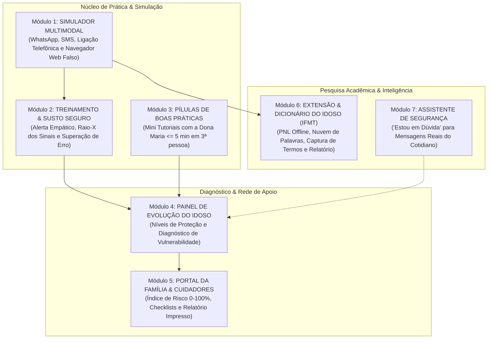

# 02. Arquitetura Conceitual e Módulos do Sistema (Atualizado)

## 1. Os Módulos Integrados da Plataforma

---

## 2. Detalhamento dos Módulos

### 📱 Módulo 1 — Simulador Multimodal de Golpes
* Ambientes digitais e telefônicos realistas e isolados (sem conexão com APIs reais de bancos ou operadoras):
  - **WhatsApp / SMS:** Interface idêntica com digitação, áudio, balões e temporização.
  - **Ligação Telefônica Simada:** Interface de viva-voz com teclado numérico para a Falsa Central 0800 e Golpe do Motoboy.
  - **Navegador Web Falso:** Barra de endereços com domínios suspeitos (`.xyz`), cadeado de segurança e formulários de login/senha interceptados com segurança.
* 6 grandes cenários reais mapeados (Falso Filho, Alerta de Banco, Falsa Central 0800, Prova de Vida do INSS, Falso Motoboy e Presente com Taxa).

### 🎓 Módulo 2 — Treinamento e Metodologia do Susto Seguro
* Detecção imediata do momento crítico (quando o usuário tenta enviar o Pix ou fornecer dados).
* Tela acolhedora de interrupção empática: *"🚨 PARE! Você caiu em uma simulação, fique 100% tranquilo!"*.
* Desconstrução em 4 abas pedagógicas: O Seu Erro, Raio-X dos Sinais, Gatilhos Psicológicos e O Que Fazer Passo a Passo (Regra de Ouro).
* Mecanismo de Superação de Erro com troféu de aprendizagem quando o participante repete e acerta.

### 🎬 Módulo 3 — Pílulas de Boas Práticas (Mini Tutoriais da Dona Maria)
* Formato de Microlearning (3 a 5 minutos) com foco em **descentração cognitiva**.
* O idoso não é a vítima pressionada, mas sim o **conselheiro protetor da Dona Maria**, Seu Raimundo ou Dona Francisca.
* Histórias ilustradas com dilemas de 2 decisões e desfecho imediato que fixa a regra de ouro sem cansaço mental.

### 🛡️ Módulo 4 — Diagnóstico e Painel de Evolução do Idoso
* Acompanhamento individual de progresso:
  - Nível 1: Iniciante Digital
  - Nível 2: Prudente em Alerta
  - Nível 3: Guardião Digital Atento
  - Nível 4: Cidadão Digital Protegido (Imune)
* Matriz de competências (Urgência, Links, Bancos, Ligações, Senhas).
* Emissão de Certificado Oficial de Conclusão de Treinamento.

### 👨‍👩‍👧 Módulo 5 — Portal da Família & Cuidadores
* Cálculo automático do **Índice de Vulnerabilidade Familiar (0 a 100%)**.
* Quebra de risco por tipo de fraude (WhatsApp, Golpes Telefônicos, Golpes de Internet e Domiciliares).
* Checklist preventivo prático para a família (ex: ajuste de limites de Pix noturno, senha verbal familiar para emergências).
* Emissão de Relatório de Proteção Familiar formatado para impressão.

### 🔬 Módulo 6 — Inteligência de Extensão & Dicionário do Idoso (IFMT)
* **Motor Heurístico Offline em pt-BR:** Mais de 1.500 linhas de regras linguísticas locais que funcionam em qualquer sala sem internet.
* **Captura Automática de Vocabulário:** Termos, gírias e expressões não catalogadas são salvos no IndexedDB para servir de base científica.
* **Nuvem de Palavras e Frequência:** Classificação semântica automática (`família`, `financeiro`, `segurança`, `urgência`, `geral`).
* **Gerador de Relatório de Extensão:** Compila dados e gera relatório com gráficos para o IFMT e exportações em CSV/JSON.

### 🆘 Módulo 7 — Assistente de Segurança ("Estou em Dúvida")
* Suporte para situações reais que o idoso recebe no dia a dia.
* Protocolo preventivo imediato de 4 passos (Pausar -> Não pagar -> Não clicar -> Validar pelo canal oficial).
* Classificação semafórica de risco: 🟢 Baixo Risco | 🟡 Suspeito | 🔴 Alto Risco.

---

## 3. Diretrizes de Segurança e Privacidade (LGPD)

1. **Isolamento Total:** Nenhuma conexão financeira externa real, nenhum acesso aos contatos reais do aparelho.
2. **Privacidade Local:** Os dados do idoso ficam armazenados de forma segura no navegador local (IndexedDB) sem envio para servidores não autorizados.
3. **Respeito à Autonomia:** O portal familiar tem caráter de apoio educativo e prevenção mútua, sem vigilância punitiva.
